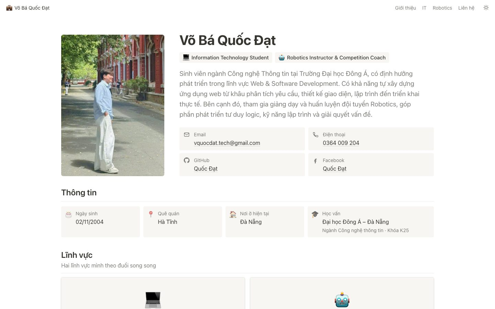
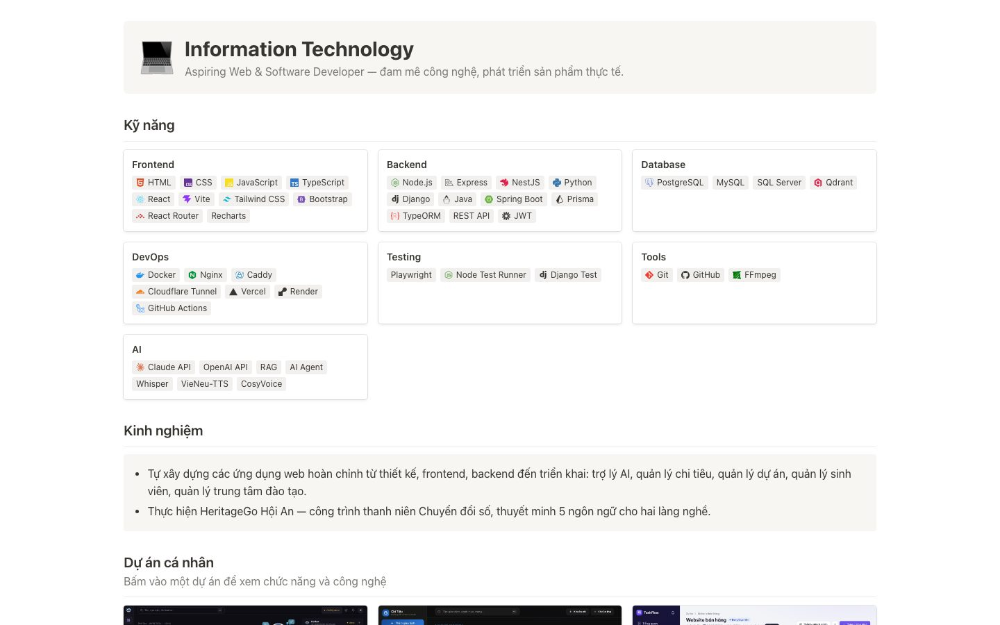

# Võ Bá Quốc Đạt — Trang cá nhân

Portfolio giới thiệu hai vai trò của mình: **sinh viên Công nghệ thông tin** tại Đại học Đông Á và **Robotics Instructor & Competition Coach**. Trang gồm thông tin cá nhân, kỹ năng, các dự án phần mềm đã làm và thành tích huấn luyện Robotics.

🔗 **Xem trực tiếp:** [tinyurl.com/voquocdat](https://tinyurl.com/voquocdat) · link gốc: https://kencongtu24-max.github.io/vo-ba-quoc-dat-portfolio/



## Nội dung trang

Toàn bộ nằm trên **một trang**, bố cục theo kiểu trang Notion (lấy cảm hứng từ mẫu *Workfolio*):

| Phần | Nội dung |
|---|---|
| **Đầu trang** | Ảnh bên trái; bên phải là tên, hai vai trò (bấm để tới phần tương ứng), đoạn giới thiệu và liên hệ (Email, Điện thoại, GitHub, Facebook) |
| **Thông tin** | Một hàng: ngày sinh, quê quán, nơi ở, học vấn |
| **Lĩnh vực** | Hai thẻ IT và Robotics, bấm để tới phần tương ứng |
| **💻 Information Technology** (`#it`) | Kỹ năng theo nhóm, kinh nghiệm, gallery dự án cá nhân / nhóm (bấm vào thẻ để mở trang chi tiết), mục tiêu |
| **🤖 Robotics & STEM** (`#robotics`) | Kỹ năng, hoạt động, kinh nghiệm giảng dạy và huấn luyện, bảng thành tích, mục tiêu |

Mỗi lĩnh vực mở đầu bằng một khung tiêu đề riêng nên hai phần tách bạch. Link `#it` và `#robotics` dẫn thẳng tới từng phần.

### Dự án nổi bật

| Dự án | Mô tả ngắn | Công nghệ chính |
|---|---|---|
| **PersonalAIAgentPro** | Trợ lý AI cá nhân: chat có RAG trích nguồn, AI Agent chờ duyệt, kho kiến thức, công việc | React 19, NestJS, PostgreSQL, Qdrant, Claude / OpenAI API |
| **FinFlow** | Quản lý chi tiêu cá nhân chạy hoàn toàn trên trình duyệt · [xem website](https://quan-ly-chi-tieu-gilt.vercel.app/#/dashboard) | React, TypeScript, Recharts |
| **TaskFlow** | Quản lý dự án và công việc, Kanban, phân quyền 4 vai trò | Django 5.2, Bootstrap 5 |
| **UniManage** | Quản lý sinh viên toàn trường cho 8 vai trò | React 19, Express, Prisma, PostgreSQL |
| **AcademyHub** | Quản lý trung tâm đào tạo Robotics, có cổng phụ huynh | React, Express, PostgreSQL, Docker Compose |
| **HeritageGo Hội An** | Hướng dẫn viên trực tuyến, thuyết minh 5 ngôn ngữ · [xem website](https://huongdanvien.tuoitredaihocdonga.org.vn) | React 18, Web Audio API, Media Session API |



## Giao diện

- **Phong cách Notion:** biểu tượng và tiêu đề trang, đường kẻ dưới tiêu đề mục, khối callout nền xám, nhãn màu, thẻ gallery và bảng database; dùng đúng bảng màu sáng / tối của Notion và font hệ thống.
- **Gallery dự án:** mỗi thẻ có ảnh chụp giao diện thật (hoặc biểu tượng nếu chưa có ảnh), loại dự án và nhãn "Đang chạy trực tuyến" cho dự án có website.
- **Trang chi tiết dự án** mở chồng lên trang chính như "peek" của Notion: ảnh bìa, thuộc tính (loại, trạng thái, website, mã nguồn, công nghệ) và danh sách chức năng. Đóng bằng nút ✕, phím Esc hoặc bấm ra ngoài; trên điện thoại trượt lên từ dưới.
- **Logo công nghệ** cho nhãn kỹ năng và công nghệ (từ [Simple Icons](https://simpleicons.org/)); logo màu quá tối tự đổi theo màu chữ để đọc được ở cả hai chế độ.
- **Sáng / tối** theo hệ thống hoặc chọn tay, lưu vào `localStorage`, không chớp sai màu khi tải trang.
- Hiển thị tốt trên điện thoại (hai cột xếp thành một); tôn trọng chế độ giảm chuyển động (`prefers-reduced-motion`).
- SEO cơ bản: meta description, Open Graph, Twitter Card, favicon.

## Công nghệ sử dụng

- [React 18](https://react.dev/) + [Vite 5](https://vitejs.dev/)
- [motion](https://motion.dev/) — hiệu ứng mở / đóng trang chi tiết dự án
- [simple-icons](https://github.com/simple-icons/simple-icons) — logo công nghệ
- GitHub Actions + GitHub Pages — tự động build và triển khai

## Cấu trúc thư mục

```
├── public/
│   └── projects/         # Ảnh chụp giao diện các dự án
├── docs/screenshots/     # Ảnh dùng trong README
├── src/
│   ├── components/       # Topbar, Profile (đầu trang), ITPart / RoboticsPart, gallery dự án, trang chi tiết, khối kiểu Notion (Blocks)...
│   ├── hooks/            # useTheme
│   ├── data.js           # Toàn bộ nội dung: kỹ năng, dự án, thành tích, liên hệ...
│   ├── techIcons.js      # Ghép tên công nghệ với logo
│   ├── App.jsx / App.css # Layout chính và style
│   └── main.jsx          # Điểm khởi chạy
└── .github/workflows/deploy.yml
```

## Chạy trên máy

Yêu cầu Node.js 20 trở lên.

```bash
npm install       # cài thư viện
npm run dev       # chạy dev server
npm run build     # build bản production vào dist/
npm run preview   # xem thử bản build
```

## Chỉnh sửa nội dung

Hầu hết nội dung nằm trong [`src/data.js`](src/data.js), sửa file này là đủ, không cần đụng vào component.

Mỗi dự án trong `itPersonalProjects` có các trường:

| Trường | Ý nghĩa |
|---|---|
| `tag`, `title`, `desc` | Loại dự án, tên, mô tả ngắn |
| `image` | Ảnh giao diện, đặt trong `public/projects/` (ví dụ `"projects/finflow.jpg"`, tỉ lệ 16:9 hoặc 16:10) |
| `link` | Website đang chạy — có thì hiện nhãn "Đang chạy trực tuyến" và dòng "Website" trong trang chi tiết |
| `repo` | Link GitHub mã nguồn — để trống thì dòng "Mã nguồn" được ẩn |
| `features` | Danh sách chức năng, hiện trong trang chi tiết |
| `tools` | Công nghệ, hiện trong trang chi tiết |

Dự án có `features` mở được trang chi tiết và đứng đầu gallery; dự án chỉ có `tag`, `title`, `desc` hiện thẻ kèm nhãn "Đang cập nhật". Biểu tượng của dự án lấy theo `tag` (`TAG_ICONS` trong [`src/components/ProjectGallery.jsx`](src/components/ProjectGallery.jsx)).

Các mục khác cũng nằm trong `data.js`: `headline` (đoạn giới thiệu ở đầu trang), `roles`, `aboutInfo`, `education`, `fields` (hai thẻ lĩnh vực), `contacts`, `achievements`... Riêng `experience` và `goals` chia theo khoá `it` / `robo`, mỗi khoá hiện trong phần của lĩnh vực đó.

**Thêm logo cho công nghệ mới:** thêm một dòng vào `RULES` trong [`src/techIcons.js`](src/techIcons.js), ví dụ `[/^redis/i, siRedis]` (nhớ import `siRedis` từ `simple-icons`). Công nghệ không có logo sẽ chỉ hiện chữ.

## Triển khai

Mỗi lần push lên nhánh `main`, workflow [`deploy.yml`](.github/workflows/deploy.yml) tự build và đăng lên GitHub Pages. Có thể chạy tay trong tab **Actions** (`workflow_dispatch`).

## Liên hệ

- Email: [vquocdat.tech@gmail.com](mailto:vquocdat.tech@gmail.com)
- GitHub: [@kencongtu24-max](https://github.com/kencongtu24-max)
- Facebook: [Quốc Đạt](https://web.facebook.com/w.daw.04/)
